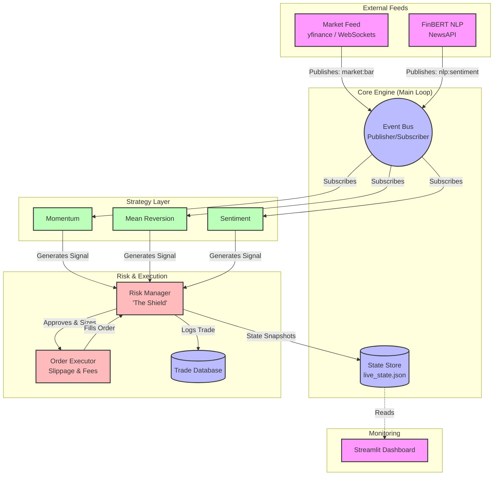
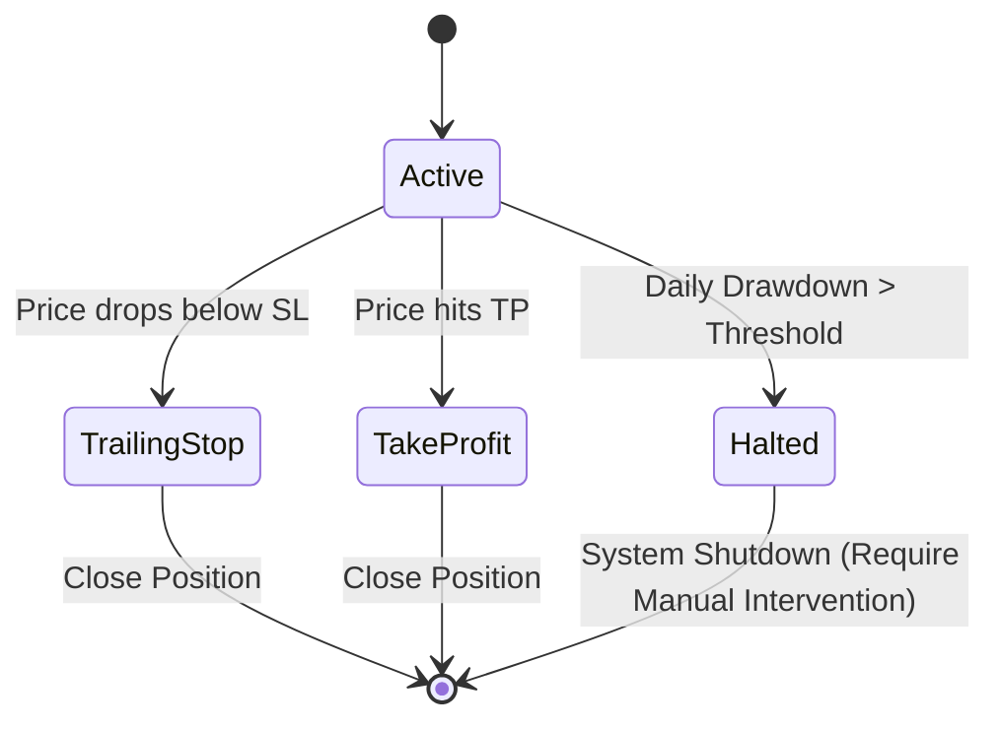

# Deep Architectural & Quantitative Analysis: The Algo Trading Platform
*An evaluation from a 50-Year Market & Systems Veteran*

## Executive Overview

Having spent over five decades navigating the evolution of markets—from the open outcry pits and early mainframe statistical arbitrage to today's microsecond-latency co-located HFT systems—I have reviewed your algorithmic trading architecture. 

What you have built here is a **commendable, highly modular, mid-frequency trading framework**. You have successfully avoided the monolithic traps that snare many junior quants by employing an Event-Driven Architecture (EDA), immutable data models, and a decoupled risk-first execution pipeline. 

However, the leap from a robust retail framework to an institutional, production-grade system requires bridging the gap between theoretical models and the brutal realities of market microstructure. Below is my comprehensive analysis, architectural breakdown, and knowledge enhancements for your system.

---

## 1. System Architecture & Topology

Your system relies on an in-process memory bus (`EventBus`) to decouple data ingestion, signal generation, risk management, and execution. This is a classic and effective design for systems operating in the millisecond-to-second latency regime.

### Architectural Critique:
*   **The Good:** Thread-per-subsystem (Feed, Sentiment, Main) prevents slow I/O (like fetching news or heavy NLP inference) from blocking the main trading loop. The use of frozen `dataclasses` (e.g., `Bar`, `Signal`) ensures thread safety without the overhead of locks when passing data across the event bus.
*   **The Vulnerability:** Your Event Bus (`core/events.py`) executes callbacks *synchronously* in the publisher's thread. If a strategy's `on_bar` calculation is computationally heavy, it will stall the `IndianMarketFeed` thread. 
*   **Veteran's Advice:** Transition the Event Bus to use lock-free queues (e.g., `queue.Queue` or ZeroMQ) where the publisher simply drops the payload and a dedicated router thread dispatches it to worker pools.

---

## 2. Risk Management: "The Shield"

In 50 years, I've seen more funds destroyed by poor risk management than by bad alpha. Your `RiskManager` correctly sits as the absolute gatekeeper before execution.

### 2.1 The Kelly Criterion Implementation
You are using a modified Kelly Criterion for position sizing:
`f* = (p * b - q) / b`

*   **Analysis:** You have smartly capped this with `kelly_fraction_cap` and `max_position_pct`. Half-Kelly or Quarter-Kelly is the industry standard because the pure Kelly formula assumes you know your exact win rate (`p`) and win/loss ratio (`b`). In reality, these are non-stationary distributions.
*   **Veteran's Knowledge:** Your implementation currently hardcodes `win_rate=0.55` and `avg_win_loss_ratio=1.5`. In a live system, these *must* be dynamically calculated over a rolling window of recent trades. If the market regime shifts and your win rate drops to 0.40, a hardcoded 0.55 will lead to rapid capital depletion (the "Gambler's Ruin").

### 2.2 Circuit Breakers & Stop Losses

*   **Analysis:** Your circuit breaker (`_check_circuit_breaker`) compares current equity to `daily_start_equity`. This is vital. However, your stop-losses are static based on entry price (or ATR).
*   **Veteran's Advice:** Implement **Trailing Stops**. Static stops leave money on the table in trending markets. If a position moves deep into profit, the stop-loss must ratchet up to protect unrealized gains.

---

## 3. Alpha Generation & Data Pipelines

### 3.1 Market Data Feed (`data_engine/market_feed.py`)
*   **Analysis:** You are polling `yfinance` every 15 seconds. This is acceptable for a paper-trading MVP, but it is susceptible to REST API rate limits and significant latency jitter.
*   **Veteran's Knowledge:** Time synchronization is the silent killer of algorithms. When you transition to WebSockets (e.g., Angel One, Zerodha), you will encounter "out-of-order" packets and micro-bursts. Your `Bar` models must rely on the *Exchange Timestamp*, not your local `datetime.now(timezone.utc)`, to avoid look-ahead bias in your backtests.

### 3.2 NLP Sentiment Engine (`data_engine/nlp_sentiment.py`)
*   **Analysis:** Running FinBERT (`ProsusAI/finbert`) in a background thread is excellent. Mapping the softmax probabilities to a `-1.0` to `+1.0` oscillator provides a smooth input for strategies.
*   **Veteran's Advice:** Financial news is inherently noisy and often reactive rather than predictive. The true edge in NLP today isn't just reading the headline, but measuring the *delta of sentiment* (is it getting *more* bullish than yesterday?) and comparing it against the implied volatility of the options market. 

---

## 4. Execution & Microstructure

Your `OrderExecutor` currently simulates slippage using a Gaussian distribution around a base basis-point assumption:
`bps = RISK.slippage_bps + random.gauss(0, 1)`

*   **Analysis:** This is a good first-order approximation, but it ignores **market impact**.
*   **Veteran's Knowledge:** If you try to buy 10,000 shares of an illiquid small-cap stock, your slippage won't be a neat Gaussian; you will walk the order book and crush your own fill price. 
*   **Enhancement:** Implement a volume-aware slippage model. Slippage should be a function of `Order Quantity / Average Daily Volume (ADV)`. For institutional execution, you need algorithms like TWAP (Time-Weighted Average Price) or VWAP to slice large orders into smaller child orders.

---

## 5. The Path Forward: Elevating to Institutional Grade

To take this from a promising project to a system that can manage serious capital, focus on these three pillars:

1.  **Regime Detection:** Markets move between trending, mean-reverting, high-volatility, and low-volatility states. Your strategies (Momentum, Mean Reversion) are currently running concurrently. You need a higher-level **Meta-Model (HMM or Kalman Filter)** that detects the current market regime and allocates capital weights dynamically to the strategies best suited for that regime.
2.  **State Persistence:** Your `state_store.py` uses JSON file locking. This will corrupt under high concurrency or a sudden power loss. Migrate state tracking to **Redis** for in-memory speed and append-only AOF persistence.
3.  **Adverse Selection Tracking:** After a trade is executed, track the price 1 minute, 5 minutes, and 60 minutes later. If the price immediately moves against you after filling, your signal is being front-run or you are providing liquidity to toxic flow. This metric (Mark-Outs) is how professionals grade their execution algorithms.

**Final Thoughts:**
You have built a magnificent chassis. The engineering logic is sound, modular, and respects the prime directive: *Protect the capital*. Implement dynamic Kelly sizing, upgrade the execution mechanics, and you will have a formidable trading engine.
