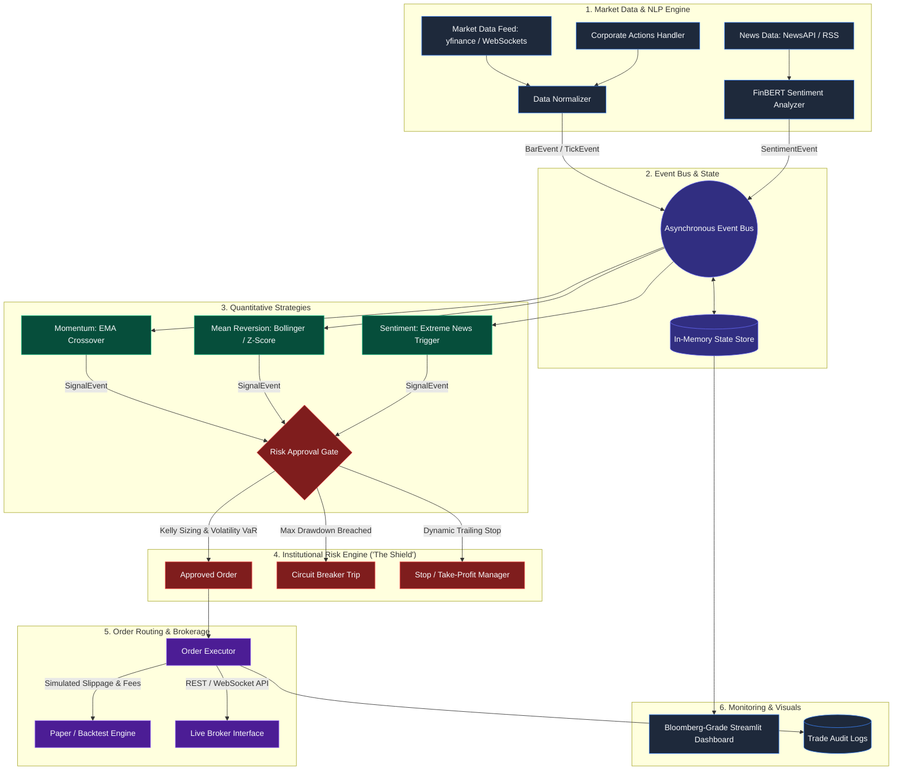

# 📈 Algorithmic Trading & Quant Strategy Engine

A **modular, event-driven, production-grade algorithmic trading platform** engineered in Python for live trading, paper simulation, and backtesting. Designed with an immutable data model, asynchronous pub/sub event bus, FinBERT sentiment intelligence, institutional risk controls ("The Shield"), and a Bloomberg-grade real-time dark theme Streamlit dashboard.

[](LICENSE)
[](https://www.python.org/)
[](https://streamlit.io/)

---

## 🏗️ System Architecture



---

## ⚡ Core Capabilities

- **Event-Driven Architecture (EDA)**: Fully decoupled pub/sub message bus routing ticks, bars, sentiment scores, and order execution events across thread boundaries without race conditions.
- **Deep NLP Sentiment Engine**: Integrates HuggingFace `ProsusAI/finbert` and NewsAPI to derive continuous real-time market sentiment scores (`-1.0` to `+1.0`) on incoming financial headlines.
- **Institutional Risk Engine ("The Shield")**:
  - Dynamic **Kelly Criterion** position sizing capped to maximum fractional exposure.
  - Volatility-adjusted Value-at-Risk (VaR) allocations.
  - Automated **Account Circuit Breaker** halting execution if intra-day drawdown crosses safety thresholds.
  - Sub-millisecond Stop-Loss and Take-Profit execution with ATR trailing mechanics.
- **Microstructure-Aware Execution**: Models realistic bid-ask bounce, volume-based execution slippage, and brokerage exchange fee structures.
- **Zero Live/Backtest Divergence**: The event-driven backtesting engine executes the exact same strategy classes, risk gates, and fill logic as live execution.
- **Bloomberg-Grade Monitoring Dashboard**: Built in Streamlit with custom CSS variables, animated ticker tape, live P&L charts, strategy performance breakdowns, and order books.

---

## 🚀 Quick Start

### 1. Prerequisites
- Python 3.10 or higher
- Git

### 2. Installation

```bash
# Clone repository
git clone https://github.com/snowowl69/algorithmic-trading-system.git
cd algorithmic-trading-system

# Create and activate virtual environment
python -m venv .venv

# Windows activation
.\.venv\Scripts\Activate.ps1

# Linux / macOS activation
source .venv/bin/activate

# Install dependencies
pip install -r requirements.txt
```

### 3. Environment Configuration

Copy the sample environment file:
```bash
cp .env.example .env
```
*(Optional: add your `NEWS_API_KEY` for live sentiment analysis; historical and mock sentiment data work out-of-the-box without keys).*

### 4. Running the Platform

#### Paper Trading (Default Simulation Mode)
```bash
python main.py
```

#### Historical Backtesting
```bash
# Run a 30-day historical replay backtest
python main.py --backtest --days 30
```

#### Real-Time Interactive Dashboard
```bash
# Launch the monitoring dashboard
streamlit run dashboard/app.py
```
*Access the live trading terminal in your browser at `http://localhost:8501`.*

---

## 📁 Repository Structure

```
algorithmic-trading-system/
├── main.py                     # CLI orchestrator & system bootstrap
├── requirements.txt            # Production dependencies
├── pyproject.toml              # Build & package configuration
├── LICENSE                     # MIT License
├── README.md                   # Platform documentation
├── Architecture_Report_50_Year_Vet.md # In-depth quantitative architecture analysis
│
├── analytics/                  # Quantitative analytics & performance metrics
│   ├── technical_indicators.py # EMA, RSI, MACD, Bollinger Bands, ATR
│   └── trade_analytics.py      # Sharpe ratio, Sortino, max drawdown, win rate
│
├── backtest/                   # Event-driven historical simulation
│   └── engine.py               # Historical bar replay & trade reconciliation
│
├── config/                     # Configuration & logging settings
│   ├── logging_config.py       # Rotating log file handlers
│   └── settings.py             # System constants, asset tickers, intervals
│
├── core/                       # Foundational models & event routing
│   ├── events.py               # BarEvent, SignalEvent, OrderEvent definitions
│   ├── models.py               # Immutable Bar, Signal, Order, Position dataclasses
│   └── state_store.py          # Atomic thread-safe portfolio state management
│
├── dashboard/                  # Real-time Bloomberg-grade dark theme UI
│   ├── app.py                  # Streamlit application with custom CSS tokens
│   └── data/                   # Dynamic ticker lists & manual trade hooks
│
├── data_engine/                # Data ingestion & NLP pipelines
│   ├── corporate_actions.py    # Stock splits and dividend adjustments
│   ├── database.py             # SQLite persistence engine & query methods
│   ├── historical_loader.py    # Multi-asset historical OHLCV downloader
│   ├── market_feed.py          # Real-time streaming market prices
│   ├── news_feed.py            # Financial news headline scraper
│   └── nlp_sentiment.py        # FinBERT transformer sentiment classifier
│
├── execution/                  # Trade execution & routing
│   └── order_executor.py       # Slippage, exchange fees, fill latency simulation
│
├── risk/                       # Risk management & portfolio protection
│   └── risk_manager.py         # The Shield: Kelly sizing, VaR, stops, circuit breaker
│
├── strategies/                 # Quantitative alpha strategies
│   ├── base_strategy.py        # Abstract Strategy class
│   ├── mean_reversion.py       # Z-Score Bollinger reversion strategy
│   ├── momentum_strategy.py    # Dual EMA trend-following strategy
│   └── sentiment_strategy.py   # FinBERT headline polarity-driven strategy
│
└── tests/                      # Pytest unit & integration test suites
    ├── test_events.py
    ├── test_execution.py
    ├── test_historical_loader.py
    ├── test_models.py
    ├── test_risk_manager.py
    ├── test_state_store.py
    └── test_strategies.py
```

---

## 🛡️ Risk Management Specifications

| Mechanism | Description | Enforcement Level |
|---|---|---|
| **Kelly Criterion Sizing** | Dynamically scales trade volume according to historical win-rate edge | Per Signal |
| **Max Position Cap** | Prevents single-asset concentration exceeding configured portfolio fraction | Per Asset |
| **Intraday Drawdown Stop** | Hard stop halting all active pipelines if daily loss exceeds limit | Account-wide |
| **Volatility VaR** | Scales entry size inversely with current 14-day ATR volatility | Entry Gate |
| **Trailing Stop Loss** | High-water mark trailing stops locking in unrealized gains | Real-time Thread |

---

## 📄 License

This project is licensed under the [MIT License](LICENSE).

---

## 📬 Author & Links

**Raghavendra**  
- GitHub: [@snowowl69](https://github.com/snowowl69)  
- Repository: [https://github.com/snowowl69/algorithmic-trading-system](https://github.com/snowowl69/algorithmic-trading-system)
